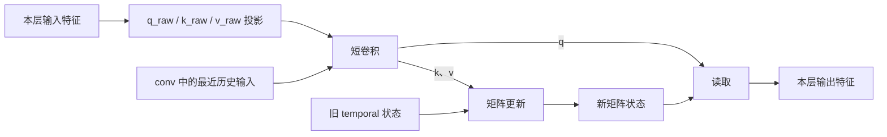

# Qwen3.6 GDN：状态、投影与 shape 学习笔记

学习日期：2026-10-13。

目标：从基础概念走进 SGLang 的实际源码，理解 GDN/Mamba 状态管理、算法与 prefix checkpoint，最终能独立解释和审查 [PR #43845](https://github.com/sgl-project/sglang/pull/43845)。

本文固定使用已测试的源码提交 [`fe7fc57d8d091adca7c350f086428fce366884c0`](https://github.com/JinyanYi/sglang/tree/fe7fc57d8d091adca7c350f086428fce366884c0)。模型配置来自本次实际使用的 Qwen3.6-35B-A3B checkpoint。以下具体数字以 TP2、PP1、普通逐 token 推理为基础；MTP 的扩展另列。

阅读约定：数学推导使用 LaTeX；实际源码与 tensor 索引保留代码格式。

## 明天先读这里

今天已经算通：q/k/v 通道数、TP2 分片、卷积窗口、temporal 的维度、索引后 shape，以及简单矩阵乘法。

**尚未真正理解的核心：每个 value head 的 $128\times128$ 矩阵究竟记住什么，怎样用 k/v 写入，再怎样用 q 读取。** 能算 $S\mathbf q$，不等于已经理解这块矩阵的算法含义。

明天从这个问题继续。先用一个很小的矩阵逐步演示写入和读取，讲清矩阵两条轴的意义，再对照真实 GDN 更新代码。之后继续状态分配、prefix cache 与 MTP。

## 我自己记得最牢的三段话

以下摘自今天的学习回答，保留已经正确的推导，并在下面补上必要的上下文。

> “(num k heads/tp size) x k dim x 2 (for q) + (num v heads/tp size) x v dim = 4096”

这是本地卷积输入通道数的正确推导。`×2` 对应 q 和 k 两段；这个模型的 q heads 数与 k heads 数相同。TP2 下，本地 q/k/v 分别是 1024、1024、2048 个通道，合计 4096。

> “t-1 -2 -3的所有qkv我们都得保留”

限定：在开始处理位置 t **之前**，基础卷积窗口需要这些位置的、**卷积前的 q/k/v 投影结果**。处理完成后，窗口保留 t、t-1、t-2。这里的 q/k/v 不是 token ID，也不是直接缓存 token embedding。

> “每个rank分到了16个head， 每个head要存一个 128x128的矩阵”

限定：这里的 16 是本地 **value heads** 数。每块矩阵的两条轴是 `[dv, dk]`。本地 q/k heads 数是 8，不能把这三类 heads 都理解成 16。

**明天的任务就是理解第三句话中的矩阵如何工作。**

## 1. 模型、算法和池的名称

本次 Qwen3.6-35B-A3B 是混合模型：40 个 decoder layers，每四层中前三层为 GDN linear attention，第四层为 full attention，共 30 个 GDN layers 和 10 个 full-attention layers。

它使用 SGLang 的 Qwen3.5 系列实现类，实际 checkpoint 的 architecture 是 `Qwen3_5MoeForConditionalGeneration`。源码文件名带 `qwen3_5` 与本次模型名称带 `Qwen3.6` 并不矛盾。

GDN 是 Gated DeltaNet。SGLang 通过 `MambaPool`、`Mamba2StateShape` 等公共设施管理它的状态。这些工程名称不意味着 GDN 的更新公式与经典 Mamba-1/Mamba-2 相同。经典选择性 SSM 与 GDN 的对照属于后续学习内容。

### Qwen 这里是不是 GQA？

本次模型的 **full-attention 层使用 GQA**：

```text
num_attention_heads = 16
num_key_value_heads = 2
head_dim = 256
```

同一组 k/v 被多个 query heads 使用，全模型中每组 k/v 服务 8 个 query heads。

GDN 层采用另一组参数：q/k heads 为 16，value heads 为 32，每个 head 的维度为 128。这里每两个 value heads 复用一组 q/k head。

两者都有 head 分组与复用，但运算不同：full attention 使用 softmax attention 与 KV cache；GDN 使用门控矩阵递推与 conv/temporal 状态。本文只把前一种称为普通 attention 的 GQA。

## 2. 输入、权重、状态和输出

- $\mathbf h_t$：位置 t 进入本层的特征。第一层的特征来源于 embedding，后续层已经经过此前各层的计算。
- $W_q,W_k,W_v$：模型学到的投影参数。同一层的参数由请求共享。
- $\mathbf q_t^{\mathrm{raw}},\mathbf k_t^{\mathrm{raw}},\mathbf v_t^{\mathrm{raw}}$：本层特征经过投影后的结果，随后进入短卷积。
- $S_t$：处理到位置 t 后的内部递推状态，属于这个请求和前缀的动态记忆。
- $\mathbf o_t,\mathbf y_t$：本层当前读出的浮点特征，交给后续计算。

输出特征要继续经过模型的后续层，最终通过 LM head 得到词表分数，再选择 token。本层的 y 不能直接当作最终生成的 token。

### 状态为什么不是最近一次输入

教学用的简单递推：

$$
s_t=\frac12 s_{t-1}+x_t
$$

从 0 开始，依次输入 10、20：

$$
\begin{aligned}
s_1&=\tfrac12\times0+10=10,\\
s_2&=\tfrac12\times10+20=25.
\end{aligned}
$$

暂停后应保存 25。恢复并输入 30，得到 $\tfrac12\times25+30=42.5$。如果错误地把最近输入 20 当作状态，则得到 40。

这说明状态是按递推规则形成的历史摘要。更新公式读取的是旧状态，不必为这个简单模块保存所有过去的输入和输出。

权重 `0.5` 已由模型持有，checkpoint 无需为每个槽位再存一份模型参数。真实混合模型继续推理时，还需要相应的 conv 历史、full-attention KV 状态与位置等信息。

## 3. 投影结果从哪里来

按列向量的数学写法：

$$
\begin{aligned}
\mathbf q_t^{\mathrm{raw}}&=W_q\mathbf h_t,\\
\mathbf k_t^{\mathrm{raw}}&=W_k\mathbf h_t,\\
\mathbf v_t^{\mathrm{raw}}&=W_v\mathbf h_t.
\end{aligned}
$$

输入是 $\mathbf h_t$，权重是 $W$，q/k/v 是结果。写成 $W_q\mathbf q_t$ 会把输入与投影结果混淆。

例子：

$$
\mathbf h_t\in\mathbb R^{2048},\qquad
W_q\in\mathbb R^{1024\times2048}
\quad\Longrightarrow\quad
\mathbf q_t^{\mathrm{raw}}\in\mathbb R^{1024}.
$$

PyTorch 常把多个位置排成行。把批量输入写成矩阵 $H\in\mathbb R^{T\times2048}$，等价投影为：

$$
Q^{\mathrm{raw}}=HW_q^{\mathsf T}
\in\mathbb R^{T\times1024}.
$$

实际源码通过合并投影 `in_proj_qkvz` 一起计算多段输出。上述独立 Wq/Wk/Wv 是理解用的拆分，不代表代码一定存放三个独立模块。

在 GDN 中，应区分卷积前的 `q_raw/k_raw/v_raw` 与经过短卷积、激活及后续归一化的 q/k/v。为了阅读方便，本文使用 `raw` 标记；源码中的变量名未必带这个后缀。

## 4. 全模型与 TP2 的通道数

本次 linear-attention 配置：

```text
linear_num_key_heads   = 16
linear_key_head_dim    = 128
linear_num_value_heads = 32
linear_value_head_dim  = 128
linear_conv_kernel_dim = 4
```

源码中对应的计算：

```python
self.key_dim = self.head_k_dim * self.num_k_heads
self.value_dim = self.head_v_dim * self.num_v_heads
self.conv_dim = self.key_dim * 2 + self.value_dim
```

用 $C_q,C_k,C_v$ 表示三段通道数，全模型：

$$
\begin{aligned}
C_q&=16\times128=2048,\\
C_k&=16\times128=2048,\\
C_v&=32\times128=4096,\\
C_{\mathrm{conv}}&=C_q+C_k+C_v=8192.
\end{aligned}
$$

TP2 时，q/k/v 三段分别按 heads 分片。每个 rank 都拥有三段各自的一半：

$$
\begin{aligned}
C_q^{\mathrm{local}}&=8\times128=1024,\\
C_k^{\mathrm{local}}&=8\times128=1024,\\
C_v^{\mathrm{local}}&=16\times128=2048,\\
C_{\mathrm{conv}}^{\mathrm{local}}&=1024+1024+2048=4096.
\end{aligned}
$$

令 $H_k,H_v$ 分别为全模型 key/value heads 数，$P$ 为 TP size，则自己的通道公式可以写成：

$$
C_{\mathrm{conv}}^{\mathrm{local}}
=2\frac{H_k}{P}d_k+\frac{H_v}{P}d_v
=2\frac{16}{2}\times128+\frac{32}{2}\times128
=4096.
$$

它不是把整段 `[q_full, k_full, v_full]` 随意切成前后两半。源码权重加载器分别处理 query、key、value 子块，使每个 rank 都有自己的 q/k/v。

### 原来 GitHub 评论需要修正的地方

$4096=32\times128$ 在数值上成立，但前者是 TP2 下的本地 q/k/v 合计，后者是全模型的 value 通道数。本地 v 通道实际只有 2048。

因此，conv 最后一维应解释为 **TP 分片后的 packed q/k/v channels**。dk、dv 通过三段通道数都参与了计算，但不能把最后一维直接解释成 `value heads × dv`。

## 5. conv state 保存什么

在一个通道上，kernel size 4 的因果卷积可写成：

$$
c_t=w_0x_t+w_1x_{t-1}+w_2x_{t-2}+w_3x_{t-3}.
$$

这里 $c_t$ 表示该通道的卷积输出。当前输入已经提供 $x_t$，所以历史窗口保留三个位置。每个通道有对应的卷积权重，模型权重与请求的历史输入是两类数据。

GDN 的卷积输入可以概念化为：

$$
\mathbf u_t=
\begin{bmatrix}
\mathbf q_t^{\mathrm{raw}}\\
\mathbf k_t^{\mathrm{raw}}\\
\mathbf v_t^{\mathrm{raw}}
\end{bmatrix}
\in\mathbb R^{4096}.
$$

在本次 TP2 配置下，每个 $\mathbf u_t$ 有 4096 个数。处理 t 之前，基础历史窗口保存 $\mathbf u_{t-3},\mathbf u_{t-2},\mathbf u_{t-1}$；处理完成后保留 $\mathbf u_{t-2},\mathbf u_{t-1},\mathbf u_t$。

已算通的例子：三个历史输入为 10、20、30，当前输入 40，四个权重均为 1，则卷积输出 100，新历史为 20、30、40。

窗口不随序列长度增长，因为这个卷积读取固定范围的最近历史。固定 kernel size 使这一部分每步工作量固定；卷积是否成立并不取决于缓存是否增长。

### 单层、单槽位的逻辑 shape

```python
conv_state_shape = (
    divide(conv_dim, tp_world_size),
    conv_kernel - 1,
)
```

代入本次参数：

$$
\left(\frac{8192}{2},\,4-1\right)=(4096,3).
$$

这是 `[channels, history_window]`。4096 是一个位置的数目，整个基础窗口是 $4096\times3=12288$ 个数。若 conv dtype 为 bfloat16，一层一个槽位约占 24 KiB。

## 6. temporal state 的 shape 与 head 分组

公共 shape 定义：

```python
temporal_state_shape = (
    divide(num_heads, tp_world_size),
    head_dim,
    state_size,
)
```

在此 GDN 配置中，字段对应：

```text
num_heads  = value heads = 32
head_dim   = dv          = 128
state_size = dk          = 128
```

所以每层、每槽位：

```text
temporal_state_shape = (16, 128, 128)
                      [Hv, dv, dk]
```

这表示 16 块矩阵，每块矩阵 $S\in\mathbb R^{d_v\times d_k}$。一层一个槽位共有 $16\times128\times128$ 个数；若 temporal 为 bfloat16，约占 512 KiB。

shape 不决定 dtype。conv 常用 bfloat16；本次 checkpoint 配置中的 temporal 默认值是 float32，而本次 NPU testcase 显式使用 bfloat16。

### 为什么 1024 维 q 可以与 128×128 状态配合

1024 是多个 q heads 拼接后的通道数。按一个 token 来看：

```text
q: [1024] → [8, 128]
k: [1024] → [8, 128]
v: [2048] → [16, 128]
S:          [16, 128, 128]
```

每两个 value heads 复用同一组 q/k head，各自仍有独立的 v 和 S。按 head 编号示意：

$$
\begin{aligned}
\mathbf o_t^{(0)}&=S_t^{(0)}\mathbf q_t^{(0)},
&\mathbf o_t^{(1)}&=S_t^{(1)}\mathbf q_t^{(0)},\\
\mathbf o_t^{(2)}&=S_t^{(2)}\mathbf q_t^{(1)},
&\mathbf o_t^{(3)}&=S_t^{(3)}\mathbf q_t^{(1)},\\
&\vdots &&\vdots\\
\mathbf o_t^{(14)}&=S_t^{(14)}\mathbf q_t^{(7)},
&\mathbf o_t^{(15)}&=S_t^{(15)}\mathbf q_t^{(7)}.
\end{aligned}
$$

括号中的上标表示 head 编号，下标 t 表示序列位置。

核函数用 `i_h = i_hv // (HV // H)` 表示这一对应。此处 HV=16、H=8，分组比例为 2。最终得到 16 个 128 维输出，拼接为 2048 个本地输出通道，再进入 output projection。

## 7. 矩阵如何使用：已介绍，明天重新讲清

**这一节是今天介绍过、但尚未真正理解的部分。** 明天应重新用小例子走一遍，不能只跳到结论。

### 先理解矩阵乘法的读取含义

假设 key/query 是 2 维，value 是 3 维，则 S 为 `[3,2]`。列轴对应 key/query 分量，行轴对应 value 分量。

教学矩阵：

$$
S=
\begin{bmatrix}
10&40\\
20&50\\
30&60
\end{bmatrix}.
$$

$$
\begin{aligned}
S\begin{bmatrix}1\\0\end{bmatrix}
&=\begin{bmatrix}10\\20\\30\end{bmatrix},\\[6pt]
S\begin{bmatrix}0\\1\end{bmatrix}
&=\begin{bmatrix}40\\50\\60\end{bmatrix},\\[6pt]
S\begin{bmatrix}\tfrac12\\\tfrac12\end{bmatrix}
&=\begin{bmatrix}25\\35\\45\end{bmatrix}.
\end{aligned}
$$

最后一个结果已经能独立算对。q 给各列提供读取系数，这次乘法本身不会修改 S。**还要继续理解这些列如何由历史输入写成、为什么能作为记忆。**

为了展示写入含义，可以先使用两个正交 key 与完整写入的简化例子：

$$
\begin{aligned}
\mathbf k_1&=\begin{bmatrix}1\\0\end{bmatrix},
&\mathbf v_1&=\begin{bmatrix}10\\20\\30\end{bmatrix},\\[6pt]
\mathbf k_2&=\begin{bmatrix}0\\1\end{bmatrix},
&\mathbf v_2&=\begin{bmatrix}40\\50\\60\end{bmatrix}.
\end{aligned}
$$

外积 $\mathbf v_1\mathbf k_1^{\mathsf T}$ 与 $\mathbf v_2\mathbf k_2^{\mathsf T}$ 分别写入两列。真实 key 通常是连续向量，历史会混合、遗忘与修正；每列不能直接当作一个历史 token。

### GDN 核心更新的概念写法

以下是单个 value head 的核心含义，省略 q/k 归一化、缩放和输出门控：

$$
\begin{aligned}
\overline S_t&=\alpha_t S_{t-1},\\
\widehat{\mathbf v}_t&=\overline S_t\mathbf k_t,\\
\boldsymbol\delta_t&=\beta_t\bigl(\mathbf v_t-\widehat{\mathbf v}_t\bigr),\\
S_t&=\overline S_t+\boldsymbol\delta_t\mathbf k_t^{\mathsf T},\\
\mathbf o_t&=S_t\mathbf q_t.
\end{aligned}
$$

- $\alpha_t$：遗忘门控，调整已有状态；$\overline S_t$ 是遗忘后的状态。
- k 的第一次使用：读取当前 key 已有关联的 value 预测。
- $\beta_t$：控制当前 value 与预测差异的修正量 $\boldsymbol\delta_t$。
- k 的第二次使用：通过外积指定修正写入的方向。
- q：从更新后的 S 读取本轮输出。

$\alpha_t,\beta_t$ 来自本层输入相关的门控计算；它们不是这里随手固定的常数。经典线性注意力的简单更新 $S_t=S_{t-1}+\mathbf v_t\mathbf k_t^{\mathsf T}$ 也不能直接替代完整 GDN 更新公式。

矩阵形状固定，是因为模型设定了固定的 heads、dv、dk。矩阵积累的是更新后的历史影响，并不逐位置保存完整历史。

### conv 与 temporal 如何衔接



图只展示核心状态路径，门控、归一化等计算另行理解。conv 为当前 q/k/v 提供局部历史，temporal 提供此前积累的递推记忆，两者必须对应同一个前缀位置。本层输出经过输出投影、后续层、LM head 与采样，才成为新 token。

## 8. 层数、槽位数、实际布局与索引

这部分记录今天介绍过的概念，实际分配源码尚待逐行 walkthrough。

对 TP2、PP1、无 MTP 的基础状态，若活动池有 64 个可用槽位并保留 slot 0，总槽位轴为 65：

```text
NPU conv: [30, 65, 3, 4096]
          [GDN layers, slots, window, channels]

temporal: [30, 65, 16, 128, 128]
          [GDN layers, slots, value heads, dv, dk]
```

普通布局的 conv 逻辑轴为 `[channels,window]`，本次 NPU 分配使用 `[window,channels]`。层数与槽位数位于前两维。

slot 是池中的存储位置。池容量、当前活跃请求数、某次 batch size 都是不同概念；一个请求还可能占用额外跟踪槽位。

索引例子：

```python
conv.shape == (30, 65, 3, 4096)

conv[:, 2].shape                    # (30, 3, 4096)
conv[:, torch.tensor([2])].shape    # (30, 1, 3, 4096)
conv[:, torch.tensor([2, 7])].shape # (30, 2, 3, 4096)
```

整数索引去掉被索引的轴；一维 tensor 索引保留槽位轴，其长度为选中槽位数。因此 `src.shape[2:]` 在后一类情况下得到 `(3,4096)`，表示单槽位内部的状态。

原评论中的 `[30,1,3,4096]` 必须结合打印位置判断。今天已经知道选一个槽位会得到这个形状，但尚未核实原打印是否发生在索引之后；不能只凭这个数字断言整个池容量为 1。

## 9. 与 PR 的连接：已修复，原理还要逐步读通

当前 PR 的要点是，让 checkpoint 使用活动池 **实际 tensor 的单槽位 shape**：

```python
conv_shapes=[conv.shape[2:] for conv in self.mamba_pool.mamba_cache.conv]
```

这样分配保留 NPU 布局与完整窗口，内存估算使用同一份 shape。

保存与恢复通过索引赋值写回原 buffer：

```python
c[:, ckpt_slots] = src
active_conv[:, active_slots] = c[:, ckpt_slots].to(active_conv.dtype)
```

当 slots 为 tensor 时，`dst[:, slots]` 是高级索引结果，可能是副本；对它调用 `.copy_()` 会改动副本。索引赋值 `dst[:, slots] = src` 调用原 tensor 的写入逻辑。右侧读取产生副本是允许的，因为它作为来源使用。

temporal checkpoint 做 int8 量化与恢复时的反量化，活动状态继续使用原精度；conv checkpoint 保留原生 dtype。这里压缩的是缓存状态，模型权重与活动池是另行持有的。

MTP 时，本次 NPU conv 窗口还会增加 `draft_tokens-1`。例如基础窗口 3、draft tokens 4，实际窗口为 6。当前 PR 保留完整实际形状；基础 temporal 矩阵形状不因此增加 token 轴，verify/rollback 还有另外的中间状态。**这一扩展如何更新和回滚，明天之后需要从消费者代码继续核对。**

固定活动池后，开启 int8 会另外分配 checkpoint 池；整机 HBM 不一定降低。同等缓存容量的存储更小或相近缓存内存的容量更大，才是压缩收益。运行速度还受量化、复制和节省的 prefill 影响。

本次已完成 A3、Qwen3.6-35B-A3B、TP2 的四组合功能验证：MTP 开/关 × int8 开/关，包含缓存命中答案、实际 draft 接受及容量扫描。此证据支持测试范围内的功能正确性；独立解释算法与实现仍是本次学习目标。

## 10. 最终目标：读懂完整 GDN 算法

完整参考已经单独整理为 [Qwen3.6 GDN：完整算法与源码学习目标](./qwen3-6-gdn-algorithm.md)。它从输入投影、短卷积与归一化开始，讲到 head 分组、遗忘与 delta 修正、矩阵读取、输出门控，以及 checkpoint/MTP 的学习目标。全部数学表达式使用 LaTeX，源码片段保留代码格式。

这页基础笔记继续记录已经学过的内容；完整算法页作为逐步要读懂的地图。**明天仍从每个 head 的 128×128 矩阵如何存储关联开始。**

后续可按 [论文目录](./papers/README.md) 阅读 GDN 原论文、Kimi Linear 的 KDA 推导、Kimi K3 的实际算法改动。三篇原始 PDF 已归档，KDA 对照公式统一转成本文的 `[dv,dk]` 方向，避免方阵让轴顺序错误不易被发现。

## 11. 明天从哪里继续

1. 先用单个 head 的小矩阵演示两次 k/v 写入与不同 q 读取，解释每个矩阵元素的意义。
2. 从简单外积过渡到 GDN 的遗忘、预测误差与修正，不要求先背公式。
3. 对照 kernel 的 `b_h`、`b_k`、`b_v`、`b_q`，逐行跟踪读取和写入。
4. 返回单槽位 shape，加入 30 层与槽位轴，读 `MambaPool.State` 和 NPU 实际分配。
5. 沿调用链读 checkpoint 保存、加载、prefix 命中与 slot 生命周期。
6. 加入 MTP 扩展、verify 与 rollback，再独立审查 PR 的完整快照方案。
7. 对照经典 Mamba-1/Mamba-2，理解公共状态管理接口与不同递推算法的关系。

当前无需再练习简单乘法或证明普通读取不修改矩阵；下一轮重点是矩阵的记忆含义与源码中的对应关系。

## 源码阅读入口

- [Qwen GDN 模型的通道计算：第 382 行](https://github.com/JinyanYi/sglang/blob/fe7fc57d8d091adca7c350f086428fce366884c0/python/sglang/srt/models/qwen3_5.py#L382)：key/value 维度与 conv_dim。
- [单槽位 conv/temporal shape：第 225 行](https://github.com/JinyanYi/sglang/blob/fe7fc57d8d091adca7c350f086428fce366884c0/python/sglang/srt/configs/mamba_utils.py#L225)：配置层的两类状态形状。
- [GDN 配置到公共状态参数的映射](https://github.com/JinyanYi/sglang/blob/fe7fc57d8d091adca7c350f086428fce366884c0/python/sglang/srt/configs/qwen3_next.py)：搜索 `mamba2_cache_params`。
- [递推 kernel：head 分组第 44 行](https://github.com/JinyanYi/sglang/blob/fe7fc57d8d091adca7c350f086428fce366884c0/python/sglang/kernels/ops/attention/fla/fused_recurrent.py#L44)：再向下读状态更新与输出读取。
- [活动状态池](https://github.com/JinyanYi/sglang/blob/fe7fc57d8d091adca7c350f086428fce366884c0/python/sglang/srt/mem_cache/memory_pool.py)：搜索 `class MambaPool`、`class State` 和状态分配。
- [NPU conv 分配](https://github.com/JinyanYi/sglang/blob/fe7fc57d8d091adca7c350f086428fce366884c0/python/sglang/srt/hardware_backend/npu/memory_pool_npu.py)：搜索 `_init_npu_conv_state`。
- [Checkpoint 保存与恢复：第 246 行](https://github.com/JinyanYi/sglang/blob/fe7fc57d8d091adca7c350f086428fce366884c0/python/sglang/srt/mem_cache/mamba_checkpoint_pool.py#L246)。
- [PR #43845 的 NPU testcase](https://github.com/JinyanYi/sglang/blob/fe7fc57d8d091adca7c350f086428fce366884c0/test/registered/npu/basic_function/memory_and_scheduling/test_npu_int8_mamba_checkpoint_mtp.py)。

相关主题：[MTP](../inference/multi-token-prediction.md)、[投机解码](../inference/speculative-decoding.md)、[多模态模型端到端链路](./multimodal-end-to-end-flow.md)。
